# Лабораторная работа № 1. Установка Debian на виртуальную машину и настройка SSH

## Цель:

Освоить технологию виртуализации на базе Oracle VirtualBox, развернуть гостевую операционную систему Debian, сконфигурировать сетевые интерфейсы в режимах NAT и Bridged Adapter, выполнить актуализацию системных пакетов и обеспечить безопасный удалённый доступ к ВМ посредством протокола SSH с использованием как парольной аутентификации, так и криптографических ключей.

## Используемые средства

| Компонент | Версия |
|---|---|
| Программа-гипервизор | Oracle VirtualBox 7.2.22 |
| Гостевая ОС | Debian 13 «Trixie» (amd64, netinst-образ) |
| Хост-система | Windows, терминал (Git Bash / PowerShell) |

---

## 1. Установка виртуальной машины

### 1.1. Установка VirtualBox

Установщик Oracle VirtualBox версии 7.2.22 загружен с официального сайта [virtualbox.org](https://www.virtualbox.org/wiki/Downloads). Выполнена установка программного обеспечения со стандартными параметрами конфигурации.

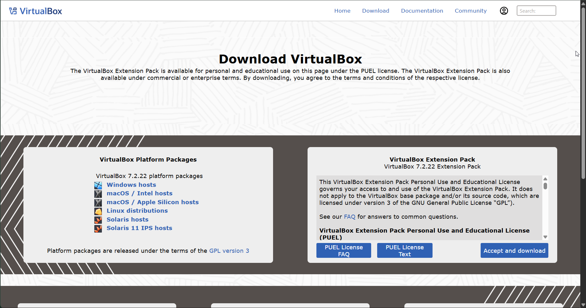

 После этого был запущен установщик и выполнена установка со стандартными параметрами и дальнейшим запуском программы-гипервизора.
 
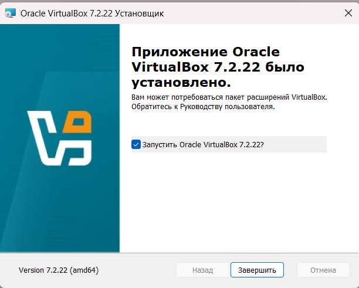
### 1.2. Создание виртуальной машины

Установочный образ `debian-13.7.0-amd64-netinst.iso` загружен с официального сайта проекта [debian.org](https://www.debian.org/):
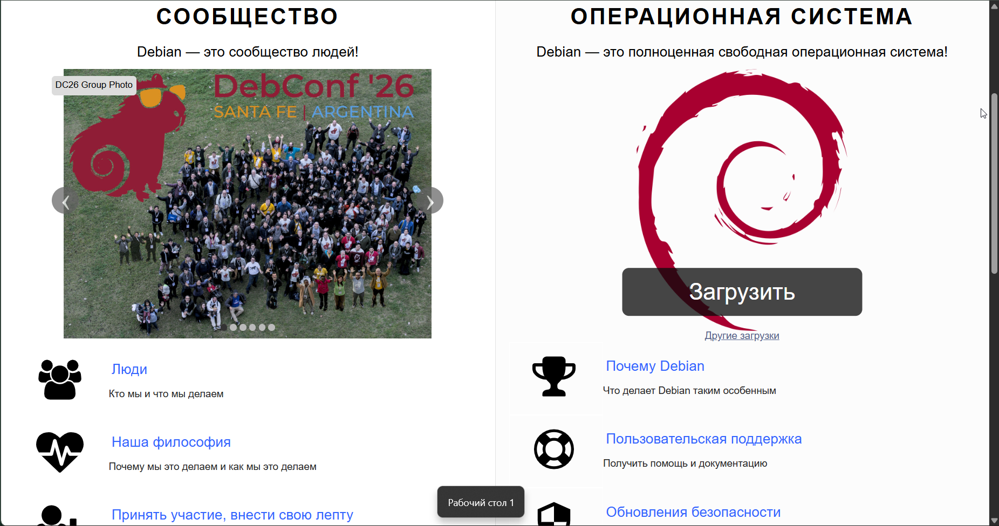

В мастере создания виртуальной машины задано имя `Debian` и указан путь к ISO-образу `debian-13.7.0-amd64-netinst.iso`. Гипервизор автоматически идентифицировал гостевую операционную систему как Debian 13 Trixie (64-bit).
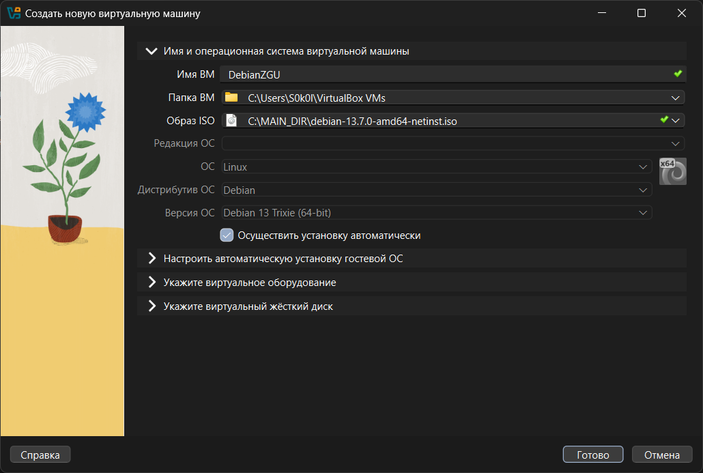

В параметрах автоматической установки были заданы следующие значения: имя пользователя `zgu`, сетевое имя хоста `Debian` и доменное имя оставляем `myguest.virtualbox.org`
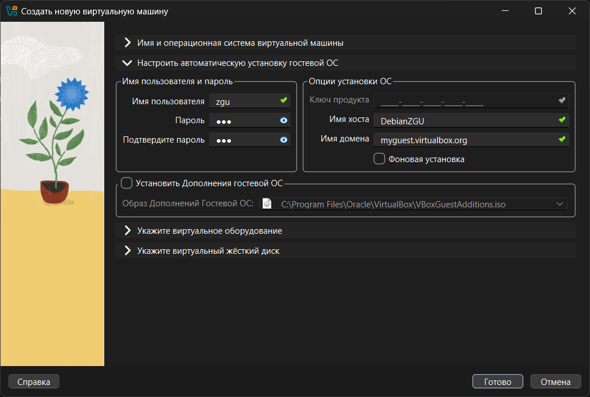

Виртуальному оборудованию выделены ресурсы согласно заданию:
- оперативная память: **4096 МБ**;
- процессор: **2 ЦПУ**;
- жёсткий диск: **20 ГБ**.
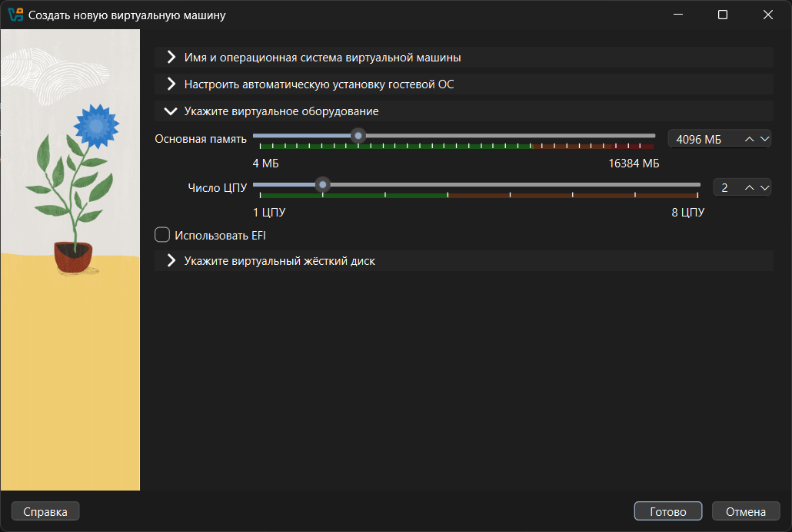
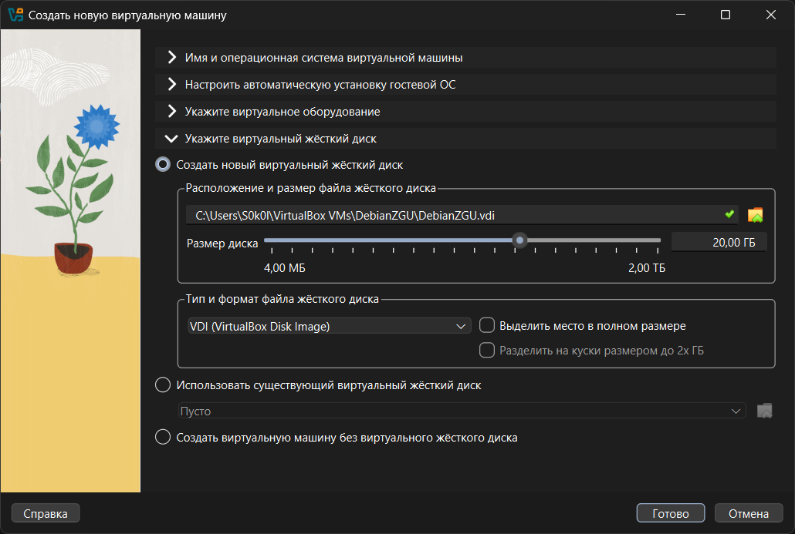
---

## 2. Установка Debian

После завершения автоматической установки виртуальная машина запустилась, и загрузился рабочий стол Debian.
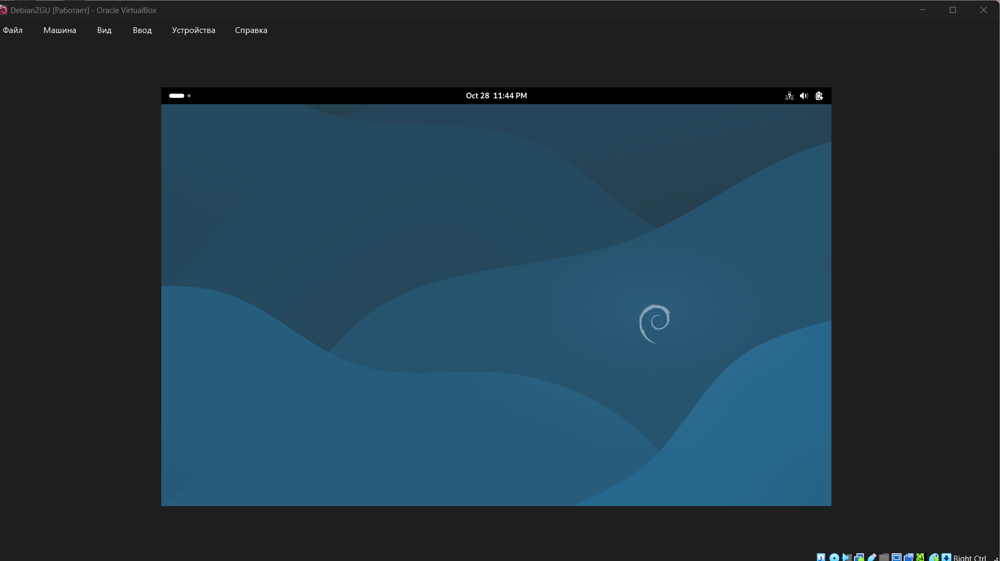

Проверка работоспособности системы с помощью запуска браузера Firefox. 
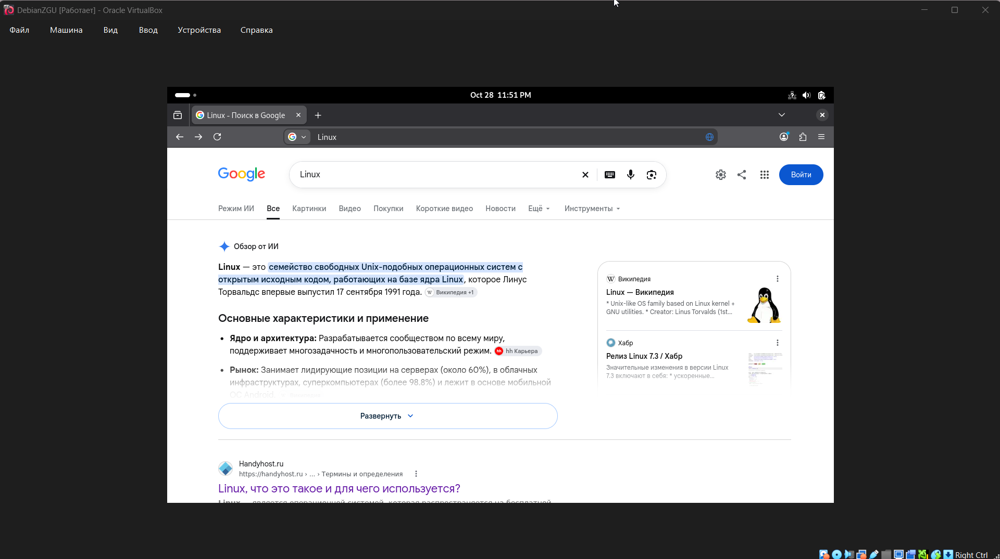

Основные параметры системы:

- Имя компьютера: `Debian`;
- Пользователь: `zgu`;

---

## 3. Настройка сети и обновление системы

### 3.1. Режим NAT и Bridge

Для первого сетевого адаптера выбран режим NAT (Bridged был протестирован, но для основной работы выбран NAT). В данной конфигурации виртуальная машина получает доступ к интернету через хост-систему, но остаётся недоступной для прямых входящих подключений из внешней сети, поэтому для организации SSH-доступа была настроена функция проброса портов.

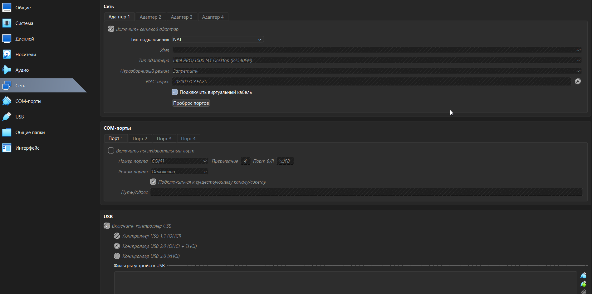

### 3.2. Обновление системы

Выполнены команды обновления списков пакетов и самих пакетов:

```bash
sudo apt-get update
sudo apt-get upgrade
```
Команды `apt-get update` и `apt-get upgrade` успешно обратились к сетевым репозиториям (`deb.debian.org`, `security.debian.org`).
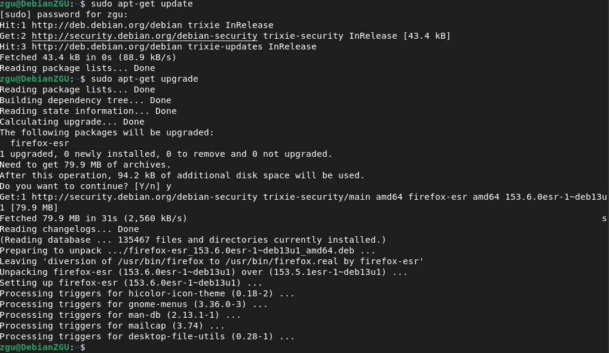

---

## 4. Настройка SSH

### 4.1. Установка SSH-сервера

Установлен пакет `openssh-server`:

```bash
sudo apt install -y openssh-server
```
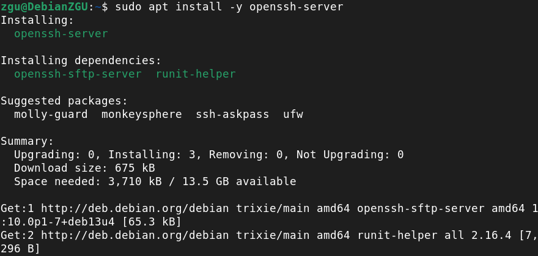

Служба SSH включена в автозагрузку и немедленно запущена. Для верификации статуса выполнена команда `sudo systemctl status ssh`. Согласно выводу, сервис `ssh.service` находится в состоянии `active (running)` и принимает входящие соединения на стандартном порту `22`.

```bash
sudo systemctl status ssh
```
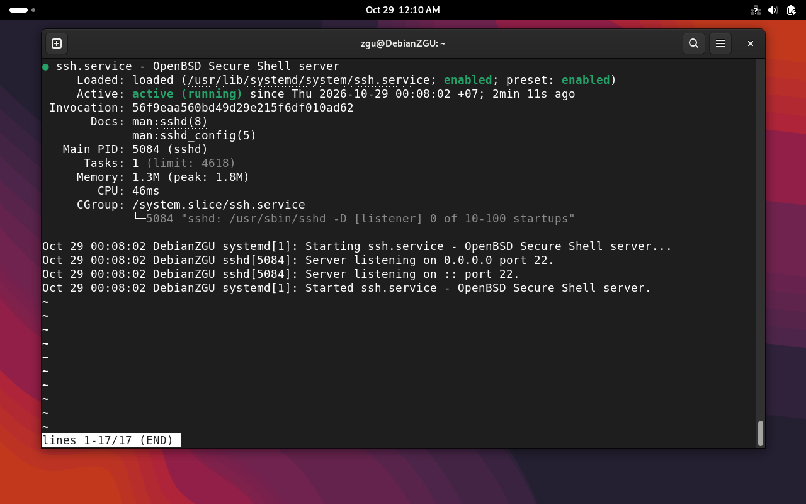

### 4.2. Проброс порта для режима NAT

Так как в режиме NAT виртуальная машина недоступна напрямую, в настройках адаптера («Проброс портов») добавлено правило:

| Имя    | Протокол | Адрес хоста | Порт хоста | Адрес гостя | Порт гостя |
| ------ | -------- | ----------- | ---------- | ----------- | ---------- |
| ssh_vm | TCP      |             | 22         |             | 22         |
Теперь подключение к порту `22` на `127.0.0.1` хоста перенаправляется на порт `22` виртуальной машины.
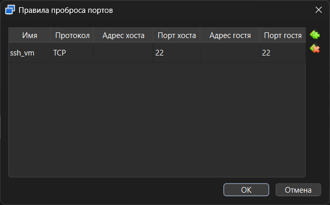

### 4.3. Подключение по паролю

С основного компьютера (Windows, PowerShell) выполнено подключение к виртуальной машине:

```bash
ssh zgu@127.0.0.1
```

После ввода пароля пользователя `zgu` вход выполнен успешно.
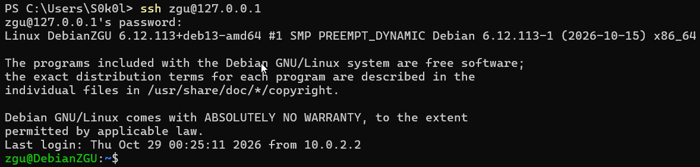

И так же подключение к виртуальной машине осуществлялось с явным указанием порта через флаг `-p`, так как стандартный порт SSH был перенаправлен на хост-систему:
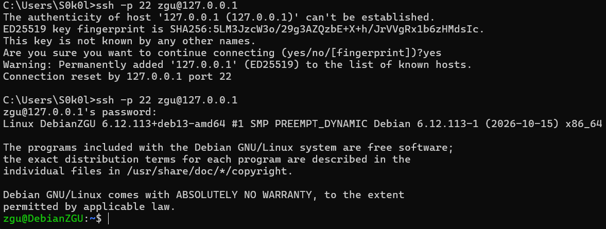

### 4.4. Подключение по ключу

Для входа без пароля использовалась пара ключей SSH (`id_ed25519`), созданная на основном компьютере командой:

```bash
ssh-keygen -t ed25519
```
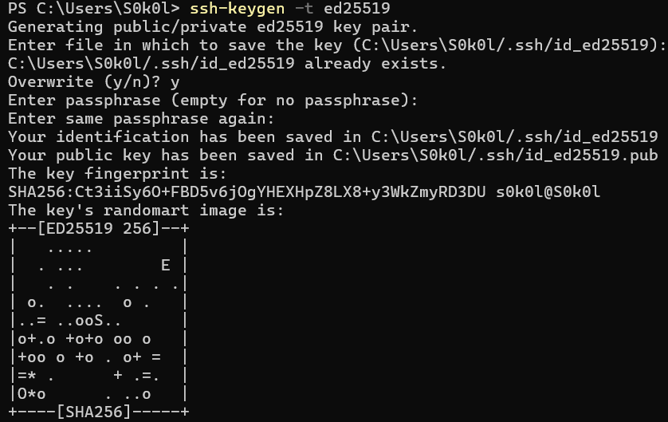

Для настройки беспарольного доступа публичный ключ (`id_ed25519.pub`) был скопирован с хост-машины и добавлен в файл `~/.ssh/authorized_keys` гостевой системы вручную через текстовый редактор `nano`.

Последовательность действий на виртуальной машине:
```bash 
mkdir -p ~/.ssh             
nano ~/.ssh/authorized_keys  
chmod 700 ~/.ssh           
chmod 600 ~/.ssh/authorized_keys 
```

После этого повторное подключение выполняется без ввода пароля:
```bash
ssh zgu@127.0.0.1
```
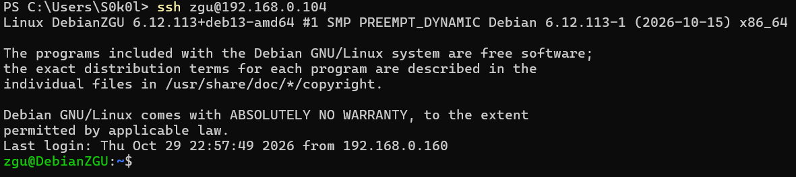


---

## Вывод

В ходе лабораторной работы установлен гипервизор Oracle VirtualBox версии 7.2.22, создана виртуальная машина с выделением 4 ГБ ОЗУ, 2 ЦПУ и диска объёмом 20 ГБ. На гостевую систему установлена ОС Debian 13 «Trixie» (amd64, netinst) с именем хоста Debian и пользователем zgu. Протестированы сетевые режимы NAT и Bridged; для основной работы выбран NAT с настройкой проброса портов (порт хоста 22 -> порт гостя 22). Выполнено обновление системы (apt-get update && apt-get upgrade), все пакеты актуализированы без ошибок. Установлен и запущен SSH-сервер openssh-server. Доступ с хост-машины организован двумя способами: по паролю и по криптографическому ключу Ed25519 (беспарольный вход через 127.0.0.1). Цель работы достигнута: освоены технологии виртуализации, настройки сети Linux и безопасного удалённого администрирования.