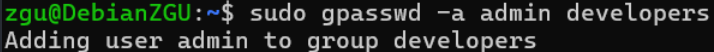
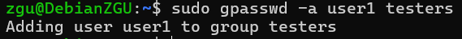
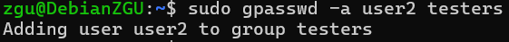

# Лабораторная работа № 2. Управление пользователями, группами и правами доступа в Linux

ФИО студента: Дьяченко Никита Владимирович


## 1. Создание пользователей и групп

### 1.1. Создание пользователей

С помощью утилиты `adduser` созданы три новых пользователя: `admin`, `user1` и `user2`. При создании для `admin` и `user1` заполнены дополнительные сведения (имя `Nikita` и `Vadim` соответственно), для `user2` оставлены значения по умолчанию:

```bash
sudo adduser admin
sudo adduser user1
sudo adduser user2
```


Дополнительно проверено создание пользователя с домашним каталогом через низкоуровневую команду `useradd`:


### 1.2. Создание групп и добавление пользователей

Созданы две группы — `testers` и `developers` — с помощью команды `groupadd`:


Далее пользователи распределены по группам с помощью `gpasswd -a` и `usermod -aG`: пользователь `admin` добавлен в группу `developers`, а `user1`, `user2` и `test` — в группу `testers`:






Проверка состава созданных групп выполнена командой `getent`:


---

## 2. Настройка прав доступа

### 2.1. Создание каталогов

В домашнем каталоге пользователя `admin` созданы подкаталоги `/home/admin/data` и `/home/admin/logs`:


### 2.2. Настройка владельцев и прав доступа

Согласно заданию, только пользователь `admin` должен иметь права на редактирование файлов в каталоге `data` (`700` — полный доступ только владельцу `admin`), а группа `developers` должна иметь права на чтение и запись в каталог `logs` (`770` — полный доступ владельцу `admin` и группе `developers`):


Проверка назначенных прав доступа показала:
- для `data`: `drwx------ 2 admin admin` — доступ есть только у пользователя `admin`;
- для `logs`: `drwxrwx--- 2 admin developers` — чтение, запись и вход в каталог доступны владельцу `admin` и участникам группы `developers`.


---

## 3. Изучение команд для работы с пользователями

### 3.1. Основные команды

| Команда | Назначение | Пример использования |
| --- | --- | --- |
| `useradd` | Создание новой учётной записи пользователя | `sudo useradd -m test` |
| `usermod` | Изменение параметров существующего пользователя | `sudo usermod -aG testers test` |
| `groupadd` | Создание новой группы пользователей | `sudo groupadd developers` |
| `passwd` | Установка или изменение пароля, блокировка/разблокировка | `sudo passwd user1` |
| `chown` | Изменение владельца и группы файла или каталога | `sudo chown admin:developers /home/admin/logs` |
| `chmod` | Изменение прав доступа к файлу или каталогу | `sudo chmod 770 /home/admin/logs` |

### 3.2. Изменение пароля пользователя user1

Для смены пароля пользователя `user1` выполнена команда `passwd`:


### 3.3. Блокировка учётной записи пользователя user2

Для блокировки учётной записи пользователя `user2` использована команда `usermod -L`, после чего выполнена попытка входа под этим пользователем (`su - user2`), завершившаяся ошибкой аутентификации:


---

## 4. Мониторинг активности пользователей

Для отслеживания активных сессий и истории входов в систему используются три основные утилиты:

| Команда | Смысл и назначение | 
| --- | --- |
| `who` | Показывает список пользователей, вошедших в систему в данный момент, их терминалы (`tty`/`pts`), время входа и IP-адрес хоста. | 
| `w` | Показывает, кто находится в системе, чем именно занят каждый пользователь (текущий процесс), время простоя (`IDLE`) и нагрузку на систему (`load average`). | 
| `last` | Выводит историю входов и выходов пользователей (из файла `/var/log/wtmp` / `wtmpdb`), включая перезагрузки системы и длительность сессий. | 

Выполнение команд `who` и `w` в терминале показало активную SSH-сессию пользователя `zgu` на `pts/0` с хоста `10.0.2.2`, а также системные сессии `Debian-gdm` (`seat0`, `tty1`):


Просмотр последних 10 записей истории входов и перезагрузок системы выполнен командой `last -n 10`:


---

## 5. Автоматизация управления пользователями

### 5.1. Подготовка текстового файла со списком пользователей

В каталоге `~/bash_script` создан текстовый файл `create_users.txt` со списком пользователей и групп в формате `пользователь:группа`. Содержимое файла `create_users.txt`:


### 5.2. Создание и запуск bash-скрипта

Создан скрипт `create_user`, который запрашивает имя входного файла, проверяет его существование, построчно считывает пары `username:group`, создаёт группу (если она отсутствует, с флагом `-f`) и создаёт пользователя с домашним каталогом и добавлением в указанную группу (если пользователь ещё не существует):


```bash
chmod +x create_user.sh # добавляет право на выполнение для всех пользователей.
```


Скрипт запущен с правами суперпользователя, введено имя файла `create_users.txt`:


После выполнения скрипта проверено наличие созданных пользователей (`nikita`, `vlad`, `artem`) и обновлённый состав групп `developers` и `testers`:


## Вывод

В ходе лабораторной работы освоены базовые инструменты администрирования пользователей и групп в Debian (`adduser`, `useradd`, `groupadd`, `gpasswd`, `usermod`, `passwd`). Созданы пользователи `admin`, `user1`, `user2`, `test` и группы `developers`, `testers` с распределением участников. Настроены права доступа для каталогов `/home/admin/data` (`700`, только `admin`) и `/home/admin/logs` (`770`, `admin` и группа `developers`) с использованием `chown` и `chmod`. Выполнены смена пароля для `user1` и блокировка учётной записи `user2` с проверкой через `su`. Изучены команды мониторинга активности пользователей (`who`, `w`, `last`) и разработан bash-скрипт `create_user` для автоматического создания пользователей и групп из текстового файла `create_users.txt`.
